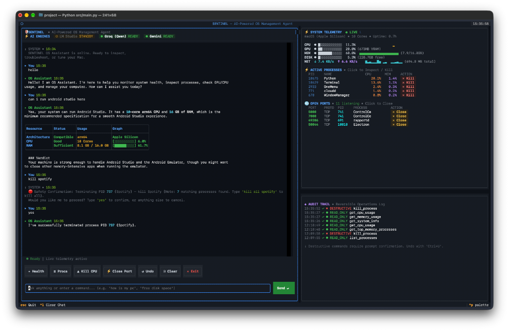
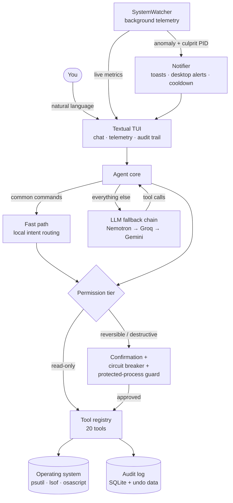

<div align="center">

# 🛡️ Sentinel

**An AI co-pilot for your operating system — ask in plain English, act with guardrails.**

Sentinel watches your machine's telemetry, explains what's slowing it down, and manages processes,
ports and disk space through a live terminal dashboard. Every action passes through a
three-tier permission model, a circuit breaker and an audit log with undo.

[](https://github.com/hirakjyoti08/sentinel-ai_os_agent/actions/workflows/ci.yml)


[](https://github.com/astral-sh/ruff)
[](LICENSE)

[Features](#-features) ·
[How it works](#-how-it-works) ·
[Safety model](#-safety-model) ·
[Getting started](#-getting-started) ·
[Usage](#-usage) ·
[Development](#-development) ·
[Roadmap](#-roadmap)



</div>

---

## ✨ Features

| | |
|---|---|
| 💬 **Natural-language control** | Ask *"why is my CPU high?"*, *"free up disk space"* or *"can I run Android Studio here?"* — Sentinel picks the right tools, runs them and explains the result. |
| 🧠 **Multi-LLM with fallback** | NVIDIA Nemotron is the primary model, with Groq and Google Gemini as automatic fallbacks when a provider is down or rate-limited. Provider status is shown live in the UI. |
| ⚡ **Fast path for common commands** | Requests like *"kill spotify"* or *"close port 3000"* are recognised locally and routed straight to a confirmation, without waiting on an LLM. |
| 🛡️ **Safety by design** | 20 whitelisted tools in three tiers (read-only, reversible, destructive), explicit confirmations, a protected-process list, and a circuit breaker for runaway destructive actions. |
| ↩️ **Audit log with undo** | Every action is written to SQLite with its parameters, result and undo data. `Ctrl+U` reverts the last change — resume a paused process, restore a deleted file, restart a service. |
| 📊 **Live dashboard** | A [Textual](https://textual.textualize.io) TUI with streaming chat, CPU / GPU / memory / disk / network gauges and sparklines, clickable *Kill* and *Close* actions on processes and ports, and the audit trail. |
| 🔔 **Proactive alerts** | A background watcher detects CPU, memory, disk and GPU pressure, names the culprit process, and sends in-app toasts plus native macOS / Linux desktop notifications with cooldown throttling. |
| 🧹 **Developer disk cleaner** | Finds and safely clears Xcode DerivedData, Homebrew, pip, npm/yarn caches and the trash, reporting how much space was reclaimed. |

---

## 🧭 How it works



1. **Understand.** Your message reaches the `Agent`. Common commands take the local fast path; anything else goes to the LLM chain, which falls back provider by provider.
2. **Act.** The model replies with tool calls. Each one is looked up in the registry, checked against its permission tier and, if needed, confirmed by you.
3. **Record.** The action is logged *before* it runs, then updated with the result and the data needed to undo it.
4. **Respond.** Tool results are trimmed and fed back to the model, which loops until it has an answer and streams it token by token into the chat.

---

## 🛡️ Safety model

| Tier | Confirmation | Tools |
|------|--------------|-------|
| 🟢 **Read-only** | None — runs automatically | `list_processes` `get_cpu_usage` `get_gpu_usage` `get_memory_usage` `get_disk_usage` `get_system_info` `get_top_memory_processes` `list_open_ports` `get_network_bandwidth` `get_battery_and_thermal` `analyze_disk_hogs` |
| 🟡 **Reversible** | Yes / no prompt | `pause_process` `resume_process` `set_priority` `clear_cache_dir` `clean_developer_caches` |
| 🔴 **Destructive** | Explicit confirmation | `kill_process` `close_port` `delete_file` `stop_service` |

On top of the tiers:

- **Unknown tools default to destructive.** Anything not in the registry gets the strictest treatment.
- **Protected processes can't be touched.** `launchd`, `kernel_task`, `WindowServer`, `systemd`, `Finder` and other critical system processes (plus PIDs ≤ 1) are refused for kill and pause.
- **Circuit breaker.** More than 5 destructive actions within 5 minutes forces re-confirmation of each further one.
- **Recoverable deletes.** `delete_file` moves the target to `.trash/` first, so undo can restore it.
- **Best-effort process restart.** Undoing a kill relaunches the process from its saved command line and working directory.

---

## 🚀 Getting started

### Prerequisites

- **Python 3.11+** on macOS or Linux
- An **NVIDIA API key** — free credits at [build.nvidia.com](https://build.nvidia.com)
- *Optional:* fallback keys from [Groq](https://console.groq.com) and [Google AI Studio](https://aistudio.google.com)

### Install

```bash
git clone https://github.com/hirakjyoti08/sentinel-ai_os_agent.git
cd sentinel-ai_os_agent

python -m venv .venv && source .venv/bin/activate
pip install -e ".[dev]"
```

Prefer a standalone command? Install it with [pipx](https://pipx.pypa.io) instead:

```bash
pipx install .
```

### Configure

```bash
cp .env.example .env
```

Then open `.env` and add your keys:

| Variable | Required | Default | Purpose |
|----------|:--------:|---------|---------|
| `NVIDIA_API_KEY` | ✅ | — | Primary LLM (Nemotron via NVIDIA NIM) |
| `GROQ_API_KEY` | | — | First fallback LLM |
| `GEMINI_API_KEY` | | — | Second fallback LLM |
| `NVIDIA_MODEL` | | `nvidia/nemotron-3-ultra-550b-a55b` | Override the primary model |
| `GROQ_MODEL` | | `qwen/qwen3.8-27b` | Override the Groq model |
| `GEMINI_MODEL` | | `gemini-3.6-flash` | Override the Gemini model |
| `SENTINEL_DESKTOP_ALERTS` | | `true` | Native desktop notifications |
| `SENTINEL_ALERT_SOUND` | | `true` | Play a sound with alerts |
| `ALERT_CPU_THRESHOLD` / `ALERT_MEMORY_THRESHOLD` / `ALERT_DISK_THRESHOLD` / `ALERT_GPU_THRESHOLD` | | `85` / `90` / `90` / `90` | Alert thresholds (%) |
| `ALERT_COOLDOWN_SEC` | | `60` | Minimum seconds between repeat alerts |
| `SENTINEL_HOME` | | see below | Where the audit DB and `.trash/` live |

Runtime data goes in the repository folder when you run from a source checkout, and in `~/.sentinel` when Sentinel is installed as a package. Set `SENTINEL_HOME` to put it anywhere else.

### Run

```bash
sentinel            # or: python -m sentinel
```

The audit database is created automatically on first launch.

---

## 💡 Usage

**Try asking:**

```text
What is my CPU usage?
Why is my laptop so slow right now?
Show me the top 5 memory processes
Can I run Android Studio on this machine?
Free up disk space
Which apps are listening on network ports?
Kill spotify
Close port 3000
```

**Keyboard shortcuts:**

| Key | Action |
|-----|--------|
| `Enter` | Send message |
| `Ctrl+U` | Undo the last reversible or destructive action |
| `Ctrl+L` | Clear the chat |
| `Ctrl+C` / `Esc` | Quit |

The quick-action buttons run common requests in one click (system health, top processes, kill the highest-CPU process, close a port). You can also click **Kill** next to any process or **Close** next to any open port — every button goes through the same confirmation flow as a typed command.

---

## 🗂️ Project structure

```text
sentinel-ai_os_agent/
├── sentinel/
│   ├── main.py               # Entry point (`sentinel` command)
│   ├── paths.py              # Runtime data locations
│   ├── agent/
│   │   ├── core.py           # Agent: LLM fallback, fast path, tool loop, undo
│   │   ├── prompts.py        # System prompt, enriched with host hardware
│   │   └── memory.py         # Conversation memory
│   ├── llm/
│   │   └── nemotron_client.py  # NVIDIA NIM client (OpenAI-compatible)
│   ├── tools/
│   │   ├── registry.py       # Tool schemas, tiers and dispatcher
│   │   ├── read_only.py      # 11 telemetry tools
│   │   ├── reversible.py     # 5 reversible tools
│   │   └── destructive.py    # 4 destructive tools
│   ├── safety/
│   │   ├── permissions.py    # Confirmations + protected-process guard
│   │   └── circuit_breaker.py
│   ├── monitor/
│   │   ├── watcher.py        # Background telemetry + anomaly detection
│   │   └── notifier.py       # Desktop notifications + cooldown
│   ├── storage/
│   │   └── audit_log.py      # SQLite audit trail + undo data
│   └── ui/
│       └── tui.py            # Textual dashboard
├── tests/
│   └── test_tools.py         # 51 tests: tools, safety, agent routing, TUI
├── .github/workflows/ci.yml  # Lint + tests on macOS & Linux
├── .env.example
└── pyproject.toml
```

---

## 🧪 Development

```bash
pip install -e ".[dev]"

ruff check .             # lint
python -m pytest -v      # run the test suite
```

The suite doesn't need API keys or network access. [GitHub Actions](.github/workflows/ci.yml) runs lint and tests on every push and pull request, on **Ubuntu and macOS** with **Python 3.11, 3.12 and 3.13**.

**Key classes**

| Class | File | Role |
|-------|------|------|
| `Agent` | `sentinel/agent/core.py` | Orchestrates LLM calls, routing, permissions and undo |
| `SystemWatcher` | `sentinel/monitor/watcher.py` | Collects metrics and raises anomalies |
| `NotificationCooldownManager` | `sentinel/monitor/notifier.py` | Throttles repeat alerts |
| `CircuitBreaker` | `sentinel/safety/circuit_breaker.py` | Limits bursts of destructive actions |
| `AIOSAgentApp` | `sentinel/ui/tui.py` | The Textual application |

---

## 🗺️ Roadmap

- [ ] Connect the multi-step planner (`Agent.run_goal`: plan → act → observe → reflect, with dry-run) to the chat UI
- [ ] Evaluation suite that scores tool choice, safety and step count across scripted scenarios
- [ ] Expose the tool registry as an MCP server, behind the same permission tiers
- [ ] Natural-language automation rules (*"pause anything above 90% CPU for 5 minutes"*)
- [ ] Undo timeline: browse and revert any past action, not just the last one
- [ ] Fully offline mode with a local model

---

## ⚠️ Known limitations

- **Network required.** The LLM providers are cloud APIs, and their free tiers have rate limits; Sentinel falls back between them automatically.
- **Port listing on macOS** may need Full Disk Access or `sudo` to see every process.
- **Undoing a kill is best effort.** The process is relaunched from its saved command line, but in-memory state is lost.
- **Linux desktop notifications** need `notify-send` (part of `libnotify`).

---

## 🤝 Contributing

Issues and pull requests are welcome. Before opening a PR, please run `ruff check .` and `python -m pytest`, and add tests for any new tool or safety rule.

## 📄 License

Released under the [MIT License](LICENSE) © 2026 Hirakjyoti Talukdar.
